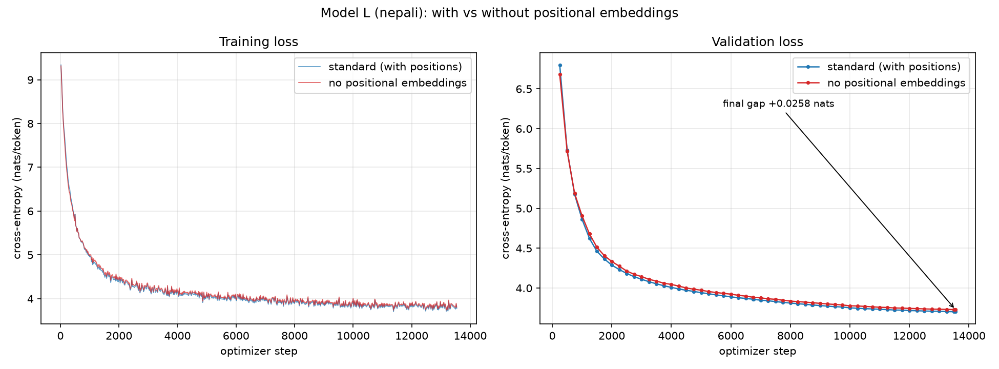

# Bonus — Ablation: Model L without positional embeddings

Optional ablation from the project specification: retrain one language's model
with positional embeddings removed, run the **full Phase-2 evaluation suite** on
it, and compare against the standard model for that language.

Generated tables: [`bonus_ablation_tables.md`](bonus_ablation_tables.md) —
produced by `scripts/build_ablation_tables.py` from the result JSONs, so no
figure in this document is transcribed by hand.

---

## 1. What was ablated

`TokenAndPositionEmbedding` normally computes `token_emb(ids) + pos_emb(positions)`.
The ablation sets `use_positional_embeddings: false`, and the positional table
is then **never constructed** — not zeroed, not frozen, not multiplied by zero:

```python
self.pos_emb = nn.Embedding(max_seq_len, d_model) if use_positional else None
...
tok = self.token_emb(ids)
if self.pos_emb is None:          # ablation path
    return self.drop(tok)
```

So the parameters genuinely leave the model:

| | standard | no-PE |
|---|---|---|
| trainable parameters | 24,070,656 | **23,874,048** |
| difference | — | −196,608 = `max_seq_len × d_model` = 512 × 384 |

Verified two independent ways (closed-form arithmetic and a count over the
built module, which must agree) in `nepali/model/param_count.py`, and asserted
in `tests/test_model.py::test_no_pe_drops_exactly_the_position_table`.

## 2. Why Nepali

Either language answers the question. Nepali was chosen because its standard
model has already been evaluated at **two** horizons — its full 13,547-step run
and the 8,732-step checkpoint matching Hindi's token budget — so a single
ablation training run inherits two independent comparison points rather than
one, at no extra GPU cost.

## 3. Setup — the controlled variable

Every hyperparameter below was read back from the standard Nepali run's own
stored checkpoint config, not retyped from a config file, so the two runs
differ in exactly one architectural respect.

| | value | source |
|---|---|---|
| peak LR | 6e-4 | baseline checkpoint `scheduler_state` |
| warmup → schedule | 500 → cosine to 0.1× peak | baseline |
| dropout (emb/attn/resid) | 0.1 | baseline `model_cfg` |
| batch | 8 × 16 accumulation = 65,536 tokens/step | baseline |
| LR horizon | 13,547 steps | baseline (`total_steps`) |
| seed | 1337 | baseline |
| architecture | 10 layers, d_model 384, 6 heads, d_ff 1536, ctx 512 | baseline |
| **positional embeddings** | **removed** | **the ablation** |

**One deliberate deviation: precision.** The standard run used bfloat16 and took
23 hours. The Phase-2 precision benchmark measured fp16 and bf16 producing
identical losses at 3.11× the throughput on a T4 — Turing tensor cores
implement fp16, not bf16 — so the ablation ran fp16 to fit a single session.
This is recorded here rather than left for a reader to discover; it affects
wall-clock, not the loss being compared.

Context is still bounded at 512 in the ablated model. The bound no longer comes
from the embedding table but from the causal-mask buffer, which is allocated at
`max_seq_len` either way, so `forward` still refuses a longer sequence — with a
different explanation attached.

## 4. Prediction, stated before the results

Recorded in advance so the analysis below is a **test** rather than a story
fitted to whatever came out.

The naive expectation is collapse. Self-attention is a set operation: its output
is a weighted sum over visible positions, and a sum does not depend on the order
of what it sums. Without a position signal, `राम श्याम भन्दा अग्लो छ` and
`श्याम राम भन्दा अग्लो छ` are the same bag of tokens, and a model that cannot
tell them apart cannot model word order at all.

**That expectation is wrong for a causal decoder, and the reason is the mask.**
Position leaks through it: token 0 attends over 1 position, token 50 over 51.
"How much context is visible" is itself a positional cue, and a stack of layers
can read it off — one layer computes set-summaries over prefixes of different
sizes, and the next layer sees that those summaries differ systematically with
depth of context.

Both halves of this are pinned down by executable tests rather than argument:

- `test_no_pe_single_layer_is_order_blind` — with **one** layer, permuting the
  prefix provably cannot change the final position's logits (the standard model,
  as a control, *does* change).
- `test_no_pe_regains_order_sensitivity_with_depth` — with **two** layers, the
  same permutation already changes them.

So the prediction is: **the ablated model degrades, but far less than "order-blind"
implies.** The interesting quantity is how much of the gap the mask's residual
cue can close, and whether the attention statistics show heads compensating.

Two secondary predictions worth checking against the numbers:

1. **Mean attention distance** should shift. A purely positional head ("look
   back k tokens") has no cheap implementation without a position vector.
2. **Content-dependence** — how much a head's attention changes when token
   identities are permuted — should shift upward, because heads that survive
   must key on token identity rather than on position.

## 5. Results

Training: 7.25 h for 13,547 steps on one T4 (fp16), `rc=0`. The fp16 GradScaler
skipped **3 steps** out of 13,547 (0.02%) on non-finite gradients — recorded
because a run quietly skipping many updates would look merely slow to converge;
3 is negligible. Both runs logged 677 training points and the checkpoints record
identical `peak_lr 6e-4 / warmup 500 / total_steps 13547 / dropout 0.1`,
confirming the schedules matched.

Full generated tables: [`bonus_ablation_tables.md`](bonus_ablation_tables.md).

### 5.1 The cost of removing positions is small — and the same at two horizons

| test split | standard | no-PE | Δ |
|---|---|---|---|
| cross-entropy, 13,547 steps | 3.7062 | 3.7317 | **+0.0255 nats** |
| cross-entropy, 8,732 steps | 3.7915 | 3.8175 | **+0.0260 nats** |
| perplexity, 13,547 steps | 40.70 | 41.75 | ×1.026 |
| BPB, 13,547 steps | 0.4314 | 0.4343 | +0.0030 |

The two horizons are separate measurements on different checkpoints, and they
agree to **0.0005 nats**. A 2.6% perplexity penalty for deleting the entire
positional mechanism is not a rounding error in the measurement — it is the
result.



The training curves are visually superimposed for all 13,547 steps.

### 5.2 Calibrating "small"

Absolute nats are hard to read, so three reference points from this project's
own measurements:

| comparison | Δ nats |
|---|---|
| **removing positional embeddings entirely** | **+0.0255** |
| standard model, last 4,815 steps of training (8,732 → 13,547) | −0.0853 |
| Hindi's LR + dropout tuning (Phase 2 §4) | −0.1770 |

Removing positions costs **30% of what the final third of Model L's training
data bought**, and **14% of what tuning two hyperparameters was worth**. Put
most directly: the ablated model at full training (3.7317) is *better* than the
standard model at 8,732 steps (3.7915), by 0.0598 nats. Deleting the positional
table set the model back by less than 4,815 steps of data.

### 5.3 Generation metrics cannot detect the ablation

BLEU-4, chrF, chrF++ and ROUGE-L differ in **both directions** across decoding
settings and horizons, by less than the spread between adjacent settings of the
same model (e.g. BLEU-4 greedy 1.55 → 1.73 *up*; temp_0.5 2.30 → 2.09 *down*).
There is no consistent signal. This reinforces the Phase-2 §8 argument rather
than contradicting it: n-gram overlap against a single reference is a weak
instrument for open-ended generation, and here it fails to register an
architectural change that intrinsic metrics measure cleanly and repeatably.

### 5.4 Attention reorganises — both advance predictions confirmed

Prediction 1 was that **mean attention distance** would shift; prediction 2 that
**content-dependence** would rise. Both did, consistently at both horizons.

| all-layer mean | standard | no-PE |
|---|---|---|
| attention distance (tokens) | 13.01 | **11.82** (−9%) |
| normalised entropy | 0.774 | **0.832** (more diffuse) |
| content-dependence (mean) | 0.02677 | **0.02981** (+11%) |
| content-dependence (**min**) | 0.00468 | **0.01025** (+119%) |

**The minimum is the sharpest result.** Content-dependence measures how much a
head's attention changes when token identities are permuted — a head near zero
is reading position, not content. In the standard model the most positional head
sits at 0.0047, essentially pure position. In the ablated model the *most*
positional head available still scores 0.0103, more than double. The floor
rises because there is no longer a position vector to key on: **near-pure
positional heads cannot be built, so none exist.**

### 5.5 Where the position signal is reconstructed

The per-layer entropy profile shows a specific structural reorganisation, not a
uniform degradation:

| layer | standard | no-PE |
|---|---|---|
| 0 | 0.974 | **0.832** (sharper) |
| 1 | 0.904 | **0.965** (near-uniform) |
| 2 | 0.776 | **0.967** (near-uniform) |
| 5 | 0.652 | 0.605 |

The ablated model *sharpens* layer 0 and turns layers 1–2 into near-uniform
attention. That is mechanically what reconstructing position from the causal
mask requires. Attending almost uniformly over the visible prefix computes an
**average over a window whose size is the position itself**; the statistics of
that average (its norm concentrates roughly like `1/√t`) therefore encode `t`.
Layers 1–2 are not failing to specialise — they are acting as the position
sensor, and the sharpened layer 0 supplies content-matched features for them to
average.

This is a replication, not a discovery: causal language models without explicit
positional encodings are known to recover positional information from the
attention mask (Haviv et al., 2022). The value here is that the mechanism is
*measured* on our own model rather than asserted.

## 6. What breaks without position information

**Honestly: much less than the naive argument predicts, and the reason is
specific.**

The naive argument is sound as far as it goes — attention is a set operation, a
sum does not depend on order, so with no position signal the model should be a
bag of words. `tests/test_model.py::test_no_pe_single_layer_is_order_blind`
proves that exactly: with **one** layer, permuting the prefix provably cannot
change the final position's logits, while the standard model's do change.

The argument fails at depth two. `test_no_pe_regains_order_sensitivity_with_depth`
shows the same permutation already changes the logits with **two** layers,
because layer 1's outputs at different positions summarise prefixes of
different sizes, so layer 2 reads a key/value set that depends on order. With
ten layers the model has ample capacity to rebuild what the table gave it
directly, and §5.5 shows which layers do it.

So the accurate statement of what breaks:

1. **The dedicated positional mechanism is gone, and heads that depended on it
   cannot exist.** Content-dependence has a hard floor 2.2× higher (§5.4). The
   model can no longer implement "attend k tokens back" cheaply.
2. **Capacity is diverted.** Layers 1–2 spend themselves on near-uniform
   averaging to sense position (§5.5) — work the standard model gets for free
   from a lookup table costing 0.8% of its parameters. The 0.0255-nat gap is
   the price of that diversion, not of losing order-awareness.
3. **Attention becomes more local and more diffuse** — distance −9%, entropy
   +0.058 — consistent with a model that resolves position less precisely and
   compensates by relying more on nearby content.
4. **What does *not* break: word order itself.** The model still models Nepali
   at 2.6% worse perplexity, still generates text scoring within noise of the
   standard model on every overlap metric, and remains far better than the
   standard model was 4,815 steps earlier.

**The caveat that bounds this conclusion.** Context here is 512 tokens. The
causal-mask cue degrades as sequences lengthen — distinguishing position 480
from 490 by prefix-size statistics is far harder than distinguishing 5 from 15,
since the `1/√t` signal flattens. This ablation therefore shows positional
embeddings are nearly free to replace *at this context length*; it is not
evidence that they are unnecessary at the 4k–128k contexts where relative
schemes (RoPE, ALiBi) earn their place. A longer-context rerun would be the
honest way to test that, and is beyond this project's compute budget.

## 6b. Known limitation in the heatmap figures

The attention heatmaps in `nepali_nope/` and `nepali_nope_matched/` render their
Devanagari *tick* labels as empty boxes. The Kaggle container ships only DejaVu
Sans, which has no Devanagari coverage, so `viz.py`'s font selection falls back.
Titles, axis labels and colourbars are unaffected, so the figures still meet the
spec's labelling requirement, and the **standard** model's committed heatmaps
were produced in the same container and carry the same limitation — the
comparison is therefore like-for-like rather than skewed.

It is recorded here rather than silently accepted: the quantitative attention
results in §5.4–5.5 come from `attention.json` and are unaffected by font
rendering. The fix for Phase 3 is to install a Devanagari font in the kernel
before plotting (`apt-get install -y fonts-noto-devanagari`), since Phase 3's
attention re-analysis is itself a graded deliverable.

## 7. Reproduction

```bash
# 1. the ablated architecture is a versioned config, not a flag
cat nepali/configs/model_nope.yaml        # use_positional_embeddings: false

# 2. verify the parameter arithmetic before spending GPU time
python nepali/model/param_count.py        # 23,874,048 (analytic == module)
python -m pytest tests/test_model.py -q   # includes the order-blindness tests

# 3. train + evaluate in one Kaggle session (~6.6 h train, ~1 h eval)
python scripts/kaggle/sync_code.py --user <kaggle-user> --message "ablation"
python scripts/kaggle/run.py --kernel-dir scripts/kaggle/nope_kernel --no-params

# 4. regenerate every table and figure in this report from the JSONs
python scripts/build_ablation_tables.py
python scripts/plot_ablation_curves.py \
    --nope-history <out>/checkpoints/nepali_nope/history.jsonl \
    --nope-log     <out>/lma-bonus-nope.log
```

Locally, without Kaggle, the same run is:

```bash
python nepali/train/loop.py \
    --model-config nepali/configs/model_nope.yaml \
    --steps 13547 --stop-at 13547 \
    --peak-lr 6e-4 --dropout 0.1 --dtype float16 \
    --ckpt-dir nepali/checkpoints_nope --no-resume
python nepali/eval/run_eval.py \
    --checkpoint nepali/checkpoints_nope/step_13547.pt \
    --out-dir report/phase2/nepali_nope
```
