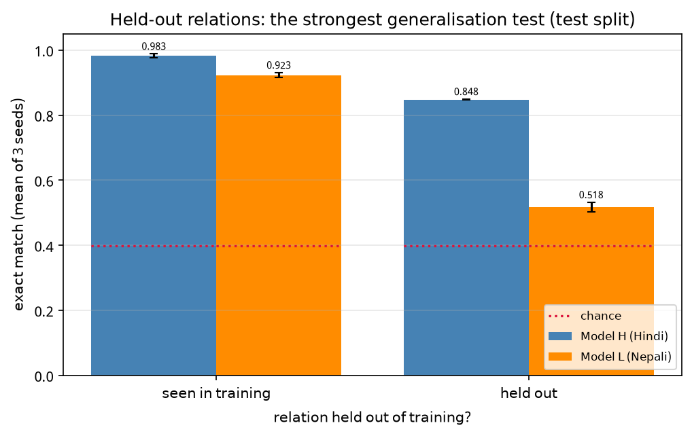
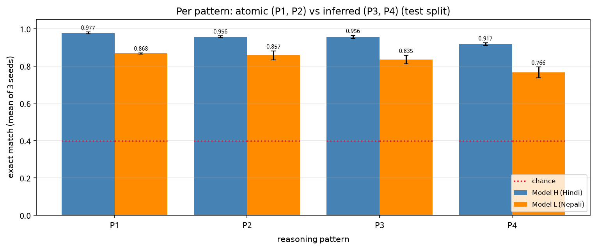
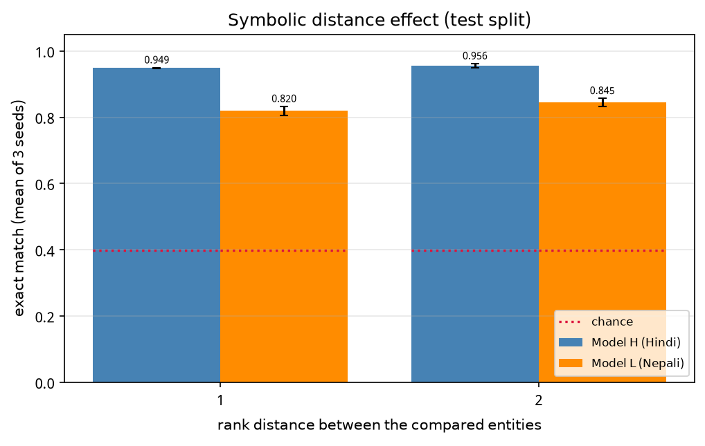
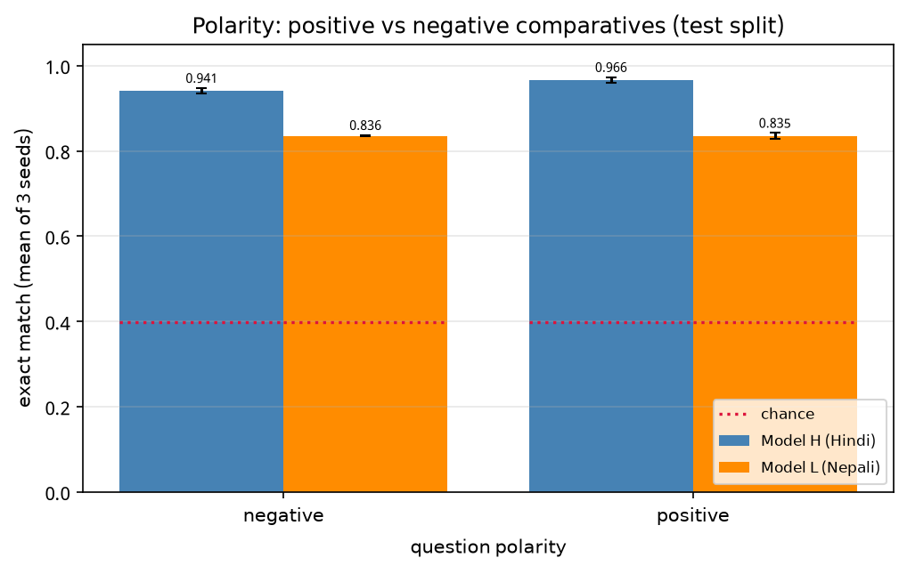
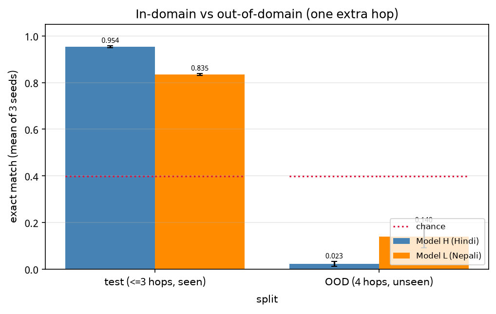

# Phase 3 — error analysis (T3.9)

Generated by `scripts/build_error_analysis.py` from `report/phase3/<tree>/reasoning_eval_v2.json` (the corrected evaluation, produced after the right-padding bug was fixed). Every cell is the mean of 3 finetuning seeds ± half the range across them.

## 1. Headline

| metric | Model H (Hindi) | Model L (Nepali) |
|---|---|---|
| test exact match | 0.954 ±0.004 | 0.835 ±0.004 |
| test closed set | 0.956 ±0.003 | 0.869 ±0.009 |
| test well formed | 0.996 ±0.002 | 0.957 ±0.008 |
| test chance | 0.398 | 0.398 |
| ood exact match | 0.023 ±0.010 | 0.140 ±0.048 |
| ood closed set | 0.024 ±0.011 | 0.152 ±0.052 |
| ood well formed | 0.988 ±0.005 | 0.940 ±0.018 |
| ood chance | 0.200 | 0.200 |

## 2. Held-out relations: the strongest generalisation test

| bucket | n | Model H (Hindi) | Model L (Nepali) |
|---|---:|---|---|
| seen in training | 4697 | 0.983 ±0.006 | 0.923 ±0.007 |
| held out | 1303 | 0.848 ±0.001 | 0.518 ±0.015 |

## 3. Per pattern: atomic (P1, P2) vs inferred (P3, P4)

| bucket | n | Model H (Hindi) | Model L (Nepali) |
|---|---:|---|---|
| P1 | 1213 | 0.977 ±0.005 | 0.868 ±0.003 |
| P2 | 1658 | 0.956 ±0.006 | 0.857 ±0.024 |
| P3 | 2060 | 0.956 ±0.008 | 0.835 ±0.023 |
| P4 | 1069 | 0.917 ±0.007 | 0.766 ±0.029 |

## 4. Symbolic distance effect

| bucket | n | Model H (Hindi) | Model L (Nepali) |
|---|---:|---|---|
| 1 | 2282 | 0.949 ±0.001 | 0.820 ±0.014 |
| 2 | 3718 | 0.956 ±0.006 | 0.845 ±0.013 |

## 5. Polarity: positive vs negative comparatives

| bucket | n | Model H (Hindi) | Model L (Nepali) |
|---|---:|---|---|
| negative | 2963 | 0.941 ±0.007 | 0.836 ±0.001 |
| positive | 3037 | 0.966 ±0.007 | 0.835 ±0.007 |

## 6. Length generalisation

## 7. What the OOD failures actually are

**Model H (Hindi)** — 120 sampled OOD predictions across 3 seeds: 1 correct, 118 named a MIDDLE entity of the chain (98.3%, against 60.0% expected if it picked uniformly among the chain's entities), 0 named an entity not in the chain at all.

| where the prediction sits in the ordering | count |
|---|---:|
| middle (3) | 49 |
| middle (1) | 39 |
| middle (2) | 30 |
| extreme (first) | 1 |
| extreme (last) | 1 |

**Model L (Nepali)** — 120 sampled OOD predictions across 3 seeds: 12 correct, 98 named a MIDDLE entity of the chain (81.7%, against 60.0% expected if it picked uniformly among the chain's entities), 9 named an entity not in the chain at all.

| where the prediction sits in the ordering | count |
|---|---:|
| middle (1) | 37 |
| middle (3) | 36 |
| middle (2) | 25 |
| extreme (first) | 9 |
| not in chain | 9 |
| extreme (last) | 4 |

The OOD answer is always an *extreme* of the chain, so naming a middle entity is not a near-miss: it means the model has learned to answer with an entity from the chain and to pick one by position, rather than to extend the ordering by one more hop.

## 8. Qualitative wins and failures

### Model H (Hindi)

*Correct (in domain)*

| prompt | gold | predicted | pattern |
|---|---|---|---|
| नरेंद्र वर्मा से छोटा है। नरेश वर्मा से लंबा है। शंकर नरेश से लंबा है। दूसरा सबसे छोटा कौन है? | वर्मा | वर्मा | P4 |
| शंकर वीरेंद्र से कमजोर है। संतोष वीरेंद्र से मजबूत है। इन सबमें कमजोर कौन है? | शंकर | शंकर | P3 |
| नरेश वीरेंद्र से भारी है। नरेश कौशल से हल्का है। इन सबमें भारी कौन है? | कौशल | कौशल | P3 |

*Wrong (in domain)*

| prompt | gold | predicted | pattern |
|---|---|---|---|
| नेहरू नरेश से अमीर है। नेहरू मनीष से गरीब है। चेतन मनीष से अमीर है। दूसरा सबसे गरीब कौन है? | नेहरू | मनीष | P4 |

*Wrong (out of domain, 4 hops)*

| prompt | gold | predicted | pattern |
|---|---|---|---|
| नेहरू संतोष से पुराना है। कृष्ण मनीष से नया है। नेहरू कृष्ण से नया है। मनीष अनुराग से नया है। इनमें सबसे पुराना कौन है? | अनुराग | मनीष | P6 |
| नरेंद्र अनुराग से नया है। गणेश नरेंद्र से नया है। गणेश कौशल से पुराना है। नेहरू अनुराग से पुराना है। सबसे नया कौन है? | कौशल | गणेश | P6 |
| शिव शंकर से नया है। शिव गणेश से पुराना है। संतोष कौशल से पुराना है। संतोष गणेश से नया है। इनमें सबसे पुराना कौन है? | शंकर | शिव | P6 |

### Model L (Nepali)

*Correct (in domain)*

| prompt | gold | predicted | pattern |
|---|---|---|---|
| राणा युवराज भन्दा कमजोर छ। सिंह युवराज भन्दा बलियो छ। यी सबैमा कमजोर को हो? | राणा | राणा | P3 |
| सिंह घिमिरे भन्दा होचो छ। घिमिरे उपेन्द्र भन्दा होचो छ। अनमोल उपेन्द्र भन्दा अग्लो छ। दोस्रो अग्लो को हो? | उपेन्द्र | उपेन्द्र | P4 |
| ज्ञानेन्द्र बिकास भन्दा छिटो छ। रोशन बिकास भन्दा ढिलो छ। उपेन्द्र ज्ञानेन्द्र भन्दा छिटो छ। दोस्रो छिटो को हो? | ज्ञानेन्द्र | ज्ञानेन्द्र | P4 |

*Wrong (in domain)*

| prompt | gold | predicted | pattern |
|---|---|---|---|
| ज्ञानेन्द्र महेश भन्दा होचो छ। बस्नेत महेश भन्दा अग्लो छ। राणा बस्नेत भन्दा अग्लो छ। दोस्रो होचो को हो? | महेश | राणाले | P4 |
| बस्नेत युवराज भन्दा भारी छ। बस्नेत गगन भन्दा हलुका छ। यी सबैमा भारी को हो? | गगन | बस्नेत | P3 |
| घिमिरे सिंह भन्दा गरिब छ। घिमिरे कि सिंह, को धनी छ? | सिंह | घिमिरे | P1 |

*Wrong (out of domain, 4 hops)*

| prompt | gold | predicted | pattern |
|---|---|---|---|
| बिकास सिंह भन्दा पुरानो छ। ओली महर्जन भन्दा नयाँ छ। बिकास ओली भन्दा नयाँ छ। महर्जन अनमोल भन्दा नयाँ छ। यीमध्ये सबैभन्दा पुरानो को हो? | अनमोल | महर्जन | P6 |
| ज्ञानेन्द्र अनमोल भन्दा नयाँ छ। गोपाल ज्ञानेन्द्र भन्दा नयाँ छ। गोपाल गगन भन्दा पुरानो छ। बिकास अनमोल भन्दा पुरानो छ। सबैभन्दा नयाँ को हो? | गगन | गोपाल | P6 |
| महेश बस्नेत भन्दा हलुका छ। बस्नेत उपेन्द्र भन्दा हलुका छ। उपेन्द्र अनमोल भन्दा हलुका छ। महेश सिंह भन्दा भारी छ। यी सबैमा हलुका को हो? | सिंह | महेश | P6 |
